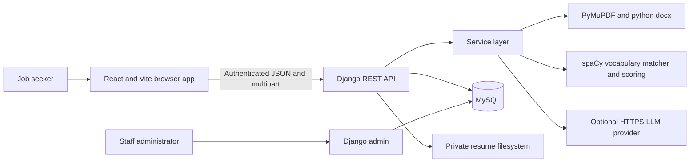
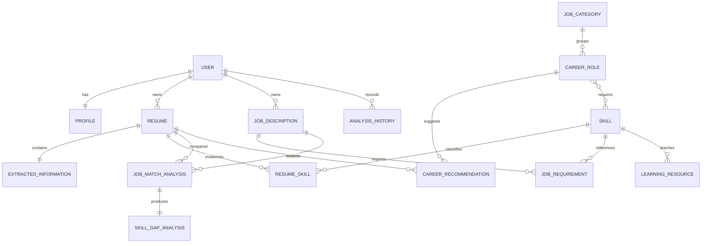
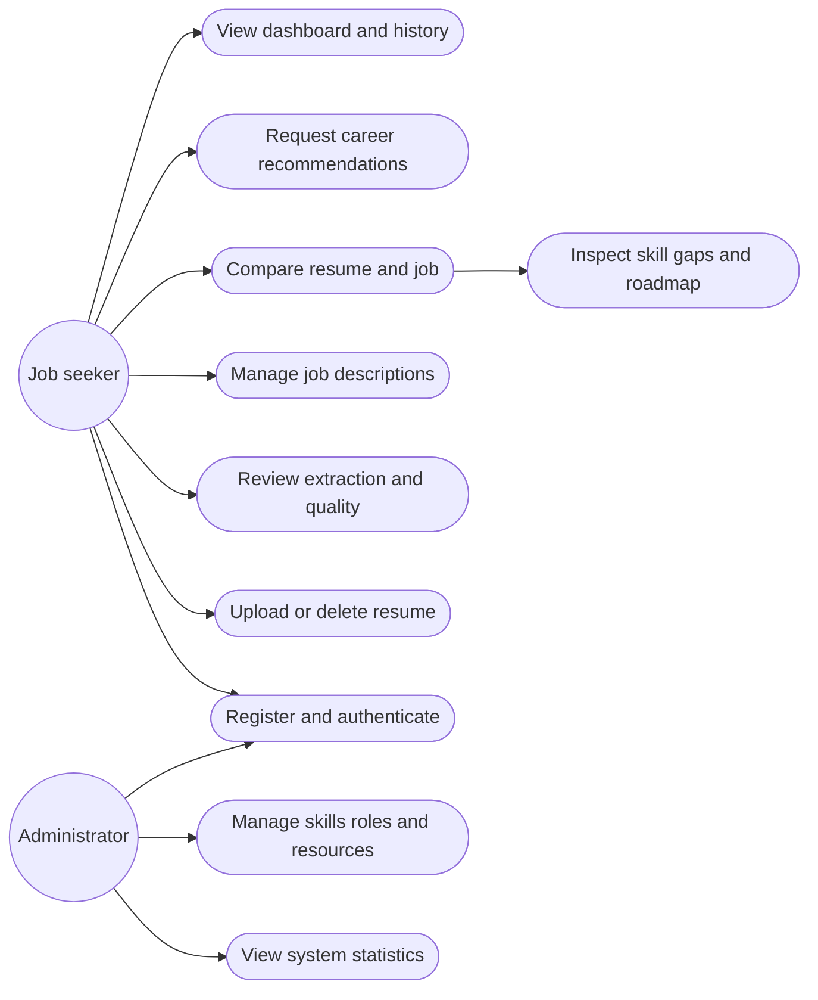
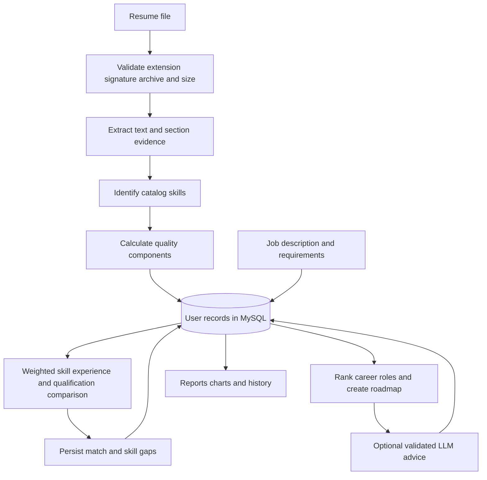

# CareerLens requirements and architecture

CareerLens helps a student or job seeker understand the evidence in a resume, compare it with a saved job, and choose a learning plan. A match score measures documented alignment; it does not estimate a hiring probability. The local engine is deterministic. An optional LLM may enrich advice after explicit user action, without replacing extracted facts or scores.

## Requirements and acceptance

1. Register, log in, revoke a token on logout, edit a profile and isolate all user-owned records.
2. Upload PDF or DOCX up to 5 MiB. Validate content as well as extension, extract text, reject scans with an actionable OCR message, retain originals in private storage and authorize downloads.
3. Extract contact details, section evidence and vocabulary-based skills with spaCy phrase matching. Display unknown fields honestly. Explain every quality component and show the extracted text.
4. Create, edit, search and delete jobs with weighted essential/preferred requirements, experience and qualification text.
5. Persist a versioned match with full, related and missing skills, scored components, qualification evidence and caveats. Persist its skill gaps and learning roadmap in the same transaction.
6. Recommend roles from an administrator-managed catalog. Persist role recommendations and learning resources.
7. Validate optional provider output against a strict schema, allow only configured HTTPS endpoints, enforce a timeout and fall back on invalid responses, rate limits or network errors. Credentials stay on the server.
8. Derive dashboard metrics, trends, top skills and history from the logged-in user's MySQL records. Empty accounts show empty states.
9. Expose staff-only operational statistics and Django admin catalog management.
10. Provide reproducible tests, API/Postman documentation, diagrams, a report, slides and a demonstration guide.

## System architecture

## Database ER diagram

Foreign keys enforce ownership chains and cascades. ResumeSkill and JobRequirement have unique pairs. Scores have 0–100 validators. JSON fields retain immutable scoring evidence and provider provenance; reusable skills, requirements and resources use relational tables. User/time indexes support recent-history queries. Deleting a source deletes its dependent analyses; original files are also removed.

## UML use cases

## Data flow

## Implementation milestones

Build storage and service contracts first, then wire all pages to those contracts. Verify parsing and access control on MySQL before browser demonstrations. Use synthetic fixtures only in tests and an explicitly labeled optional demo seed, never as hidden dashboard data. Finish documentation from actual test output and captured application screens.

## Project structure

`backend/config` contains settings and routing. `backend/core` contains models, serializers, permissions, API views and tests. `backend/core/services` owns parsing, matching, career ranking and provider validation. `frontend/src` contains the API client, authentication provider, reusable UI and routed pages. `scripts` contains setup, database and demonstration helpers. `docs` and `outputs` hold academic deliverables.
