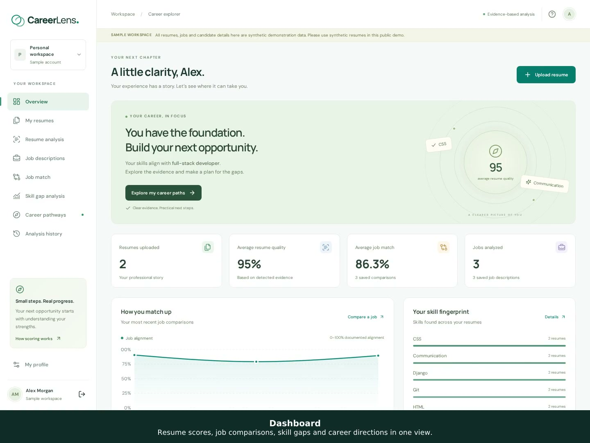

# CareerLens feature walkthrough

[Watch online](https://careerlens.rushabh.dev/demo/) · [Download the MP4](careerlens-demo.mp4) · [English captions](careerlens-demo.vtt)

A **3 minute 39 second** screen recording of the real hosted application, including desktop, staff and mobile flows. The MP4 is H.264 at 1440 × 1080 and 25 fps, about 4.4 MiB, with explanatory captions and no narration. All candidate data is fictional.

## Chapters

| Time | Feature                      |
| ---- | ---------------------------- |
| 0:00 | CareerLens                   |
| 0:06 | Accounts                     |
| 0:11 | Dashboard                    |
| 0:22 | Progress at a glance         |
| 0:26 | Resume library               |
| 0:41 | PDF upload                   |
| 0:49 | Resume analysis              |
| 0:59 | Actionable feedback          |
| 1:05 | Skill evidence               |
| 1:12 | DOCX support                 |
| 1:17 | Job descriptions             |
| 1:24 | Editable requirements        |
| 1:30 | Job matching                 |
| 1:38 | Matched, related and missing |
| 1:45 | Transparent scoring          |
| 1:50 | Skill gap roadmap            |
| 2:04 | Career recommendations       |
| 2:12 | Personal learning plans      |
| 2:19 | Analysis history             |
| 2:26 | Search saved work            |
| 2:30 | Profile and persistence      |
| 2:39 | How scoring works            |
| 2:50 | Control your files           |
| 2:54 | Your next chapter            |
| 3:01 | Staff administration         |
| 3:09 | Django administration        |
| 3:15 | Managed skill catalog        |
| 3:22 | Mobile workspace             |
| 3:28 | Mobile navigation            |
| 3:33 | Learning on the go           |

The recording demonstrates original and report downloads, PDF/DOCX parsing, score explanations and evidence, job creation/editing, matching, prioritized skill gaps, career recommendations, optional AI fallback, searchable history, saved profiles, deletion, staff statistics, catalog administration and responsive navigation. The optional provider is not configured, so no live AI response is represented as verified.

Sign-in credentials and sessions are kept outside the footage. The staff section uses a private administrator session; shared-demo visitors cannot access that module. Raw recordings, downloaded reports and session files stay in ignored `.runtime/`.

To reproduce the capture, see [the recording instructions](../DEPLOYMENT.md#record-and-publish-a-new-walkthrough). `chapters.json` and the WebVTT file provide machine-readable timing.
